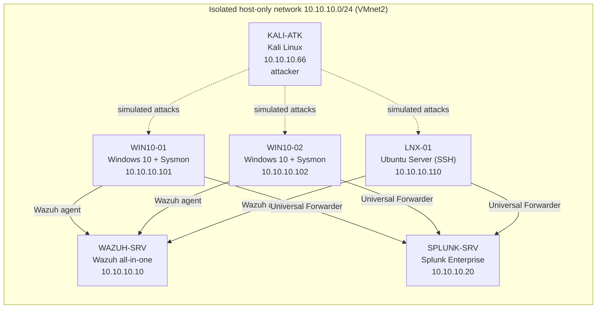

# SOC Threat Detection & Incident Response Home Lab

A hands-on Security Operations Center (SOC) home lab for practicing log collection, threat detection,
alert triage, and incident response with two SIEM platforms: **Splunk** and **Wazuh**.

The lab ingests Windows and Linux telemetry (Windows Security, Sysmon, PowerShell, Linux auth logs),
runs controlled attack simulations in an isolated network, and documents each investigation as a
structured incident report mapped to **MITRE ATT&CK**.

> **Status: in progress (2026 – present).** The table below shows what has actually been built and
> tested. Items move from `Planned` to `Done` only once there is evidence (queries, alerts, screenshots)
> in this repository.

---

## Lab architecture

| Host | Role | OS | RAM |
|---|---|---|---|
| `WAZUH-SRV` | SIEM #1 (manager, indexer, dashboard) | Ubuntu 64-bit | 4 GB |
| `SPLUNK-SRV` | SIEM #2 (Splunk Enterprise, Free license) | Windows 10 | 4 GB |
| `WIN10-01` | Monitored endpoint | Windows 10 + Sysmon | 2–3 GB |
| `WIN10-02` | Monitored endpoint | Windows 10 + Sysmon | 2–3 GB |
| `LNX-01` | Monitored endpoint (SSH target) | Ubuntu Server | 1 GB |
| `KALI-ATK` | Attack simulation | Kali Linux | 2 GB |

The host has 16 GB of RAM, so the two SIEMs never run at the same time. The lab runs in two phases
(Wazuh phase and Splunk phase). See [docs/01-lab-architecture.md](docs/01-lab-architecture.md).

---

## Progress

### Lab build

| Component | Status |
|---|---|
| Isolated network and IP plan | Planned |
| Windows audit policy, PowerShell logging, Sysmon | Planned |
| Wazuh server and agents | Planned |
| Splunk server and Universal Forwarders | Planned |

### Detection scenarios

| # | Scenario | MITRE ATT&CK | Splunk | Wazuh | Incident report |
|---|---|---|---|---|---|
| 1 | Windows brute-force logon | [T1110.001](https://attack.mitre.org/techniques/T1110/001/) | Planned | Planned | Planned |
| 2 | SSH brute-force | [T1110.001](https://attack.mitre.org/techniques/T1110/001/) | Planned | Planned | Planned |
| 3 | Suspicious PowerShell execution | [T1059.001](https://attack.mitre.org/techniques/T1059/001/), [T1027](https://attack.mitre.org/techniques/T1027/) | Planned | Planned | Planned |
| 4 | Malware-related activity (benign test files) | [T1204.002](https://attack.mitre.org/techniques/T1204/002/), [T1105](https://attack.mitre.org/techniques/T1105/) | Planned | Planned | Planned |

---

## Repository layout

| Path | Contents |
|---|---|
| [docs/](docs/) | Architecture, build guides for each component, log source reference |
| [detections/splunk/](detections/splunk/) | SPL detection queries with logic, thresholds, and tuning notes |
| [detections/wazuh/](detections/wazuh/) | Custom Wazuh rules (`local_rules.xml`) and built-in rules used |
| [detections/sysmon/](detections/sysmon/) | Sysmon configuration used on Windows endpoints |
| [detections/mitre-coverage.md](detections/mitre-coverage.md) | Technique → data source → detection coverage matrix |
| [attack-simulations/](attack-simulations/) | Safety rules and test plans for each scenario |
| [incidents/](incidents/) | Incident report template (NIST SP 800-61 lifecycle) and completed reports |
| [assets/](assets/) | Diagrams and screenshots used as evidence |

---

## Skills practiced

- SIEM deployment and log onboarding (Splunk, Wazuh)
- Windows event logging: Security auditing, Sysmon, PowerShell Script Block Logging
- Detection engineering: SPL queries and Wazuh rules with thresholds and false-positive tuning
- Alert triage: true and false positive analysis, IOC identification
- MITRE ATT&CK mapping
- Incident response documentation following the NIST SP 800-61 lifecycle

## Safety

All simulations run against virtual machines I own, on an isolated host-only network.
Malware scenarios use benign industry test files (EICAR) and Atomic Red Team tests, never real malware.
See [attack-simulations/README.md](attack-simulations/README.md).

## License

[MIT](LICENSE)
